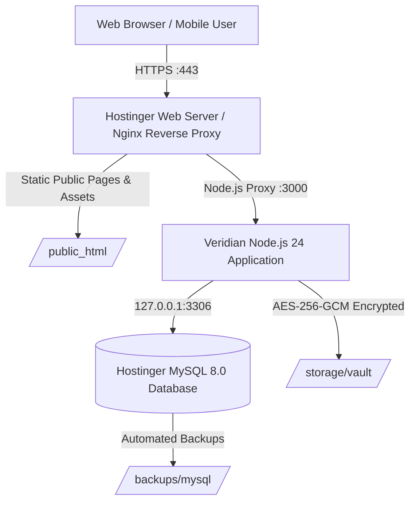

# Veridian Connector OS — Hostinger Production Deployment Guide
## Complete Setup for Hosting, Hostinger MySQL, Domain, SSL, and Google Search Console

This guide provides step-by-step instructions for deploying **Veridian Connector OS — Loan Connector Management Software** to a **Hostinger** hosting account with **Hostinger MySQL** as the production database, custom domain configuration, free SSL, and Google Search Console local SEO verification.

---

## 📋 Architectural Overview

Veridian Connector OS utilizes a dual-database architecture:
1. **Local Development & Automated Testing:** Zero-dependency, ultra-fast `node:sqlite` in WAL mode (`npm test` executes in <1 second with complete test isolation).
2. **Hostinger Production:** Native **Hostinger MySQL 8.0** (`DB_CLIENT=mysql`) with InnoDB transaction safety, UTF8mb4 encoding, connection pooling, SHA-256 backup verification, and AES-256-GCM encrypted document vaulting.



---

## 🔒 Owner Responsibility Checklist (Prerequisites)

Before starting the deployment, ensure the following prerequisites are prepared:

| Prerequisite | Description | Owner Action |
| :--- | :--- | :--- |
| **Hostinger Account** | Active Hostinger plan supporting Node.js (Business Web Hosting, Cloud Startup, or Hostinger VPS). | Log in to [Hostinger hPanel](https://hpanel.hostinger.com). |
| **Domain Name** | Custom domain (e.g. `veridianconnector.com` or your company domain). | Point DNS to Hostinger nameservers or configure A records. |
| **MySQL Database** | Created in Hostinger hPanel with user and password. | Create via **hPanel → Databases → MySQL Databases**. |
| **Google Search Console** | Google account with access to Search Console for domain ownership verification. | Open [Google Search Console](https://search.google.com/search-console). |

> [!CAUTION]
> **No Automated Financial Charges:** Antigravity and automated deployment scripts will **never** purchase domains, modify DNS without authorization, or make paid account upgrades. All account provisioning must be executed or authorized directly by the account owner.

---

## Step 1: Create Hostinger MySQL Database

1. Log in to **Hostinger hPanel**.
2. Navigate to **Websites** → Select your website → **Databases** → **MySQL Databases**.
3. Under **Create a New MySQL Database and Database User**:
   - **Database Name:** e.g., `u123456789_veridian` (Hostinger automatically prefixes your account ID).
   - **Database Username:** e.g., `u123456789_vuser`.
   - **Password:** Generate a strong password (minimum 16 characters with letters, numbers, and symbols).
4. Click **Create**.
5. Note the following values for your `.env` configuration:
   - **MySQL Host:** `127.0.0.1` (on Hostinger shared/cloud web hosting, MySQL runs locally alongside Node.js).
   - **MySQL Port:** `3306`
   - **Database Name:** `u123456789_veridian`
   - **Database User:** `u123456789_vuser`
   - **Database Password:** `<YourSecurePassword>`

---

## Step 2: Configure Node.js Application in Hostinger hPanel

### For Hostinger Cloud / Business Web Hosting:
1. In hPanel, go to **Websites** → **Dashboard** → scroll to **Advanced** → click **Node.js**.
2. Click **Create Application**:
   - **Node.js version:** Select **Node.js 22 LTS** or **Node.js 24 LTS**.
   - **Application mode:** Select **Production**.
   - **Application root:** `/home/u123456789/domains/yourdomain.com/public_html` (or a dedicated application folder such as `/home/u123456789/veridian_app`).
   - **Application startup file:** `server.js`.
3. Click **Save**.

### For Hostinger VPS (Virtual Private Server):
If you are deploying on a Hostinger VPS with Ubuntu:
```bash
# Update system and install Node.js 24 LTS
curl -fsSL https://deb.nodesource.com/setup_24.x | sudo -E bash -
sudo apt-get install -y nodejs mysql-server git

# Verify installations
node -v   # v24.x.x
mysql -V  # MySQL 8.0.x

# Install PM2 process manager
sudo npm install -g pm2
```

---

## Step 3: Deploy Application Files

### Method A: Git Deployment (Recommended)
1. In hPanel, navigate to **Advanced** → **Git**.
2. Add your repository URL:
   - **Branch:** `main`
   - **Install path:** `public_html` (or your application root).
3. Click **Create & Deploy**.
4. Access Hostinger SSH or Terminal:
   ```bash
   cd ~/domains/yourdomain.com/public_html
   npm install --omit=dev
   ```

### Method B: Upload via hPanel File Manager
1. On your local machine, prepare the deployment bundle (exclude `node_modules` and local test `.sqlite` files):
   ```powershell
   # In PowerShell
   Compress-Archive -Path server.js, package.json, package-lock.json, src, public, scripts, .env.example -DestinationPath veridian_deploy.zip
   ```
2. In hPanel, open **File Manager**.
3. Upload `veridian_deploy.zip` to your application root directory and extract it.
4. Open the hPanel **SSH / Terminal** console:
   ```bash
   npm install --omit=dev
   ```

---

## Step 4: Configure Production Environment Variables

Never store secrets in public files or git. Set your production environment variables in Hostinger:

1. In hPanel Node.js selector under **Environment Variables**, or in a secured `.env` file in the application directory:
   ```env
   # Application Environment
   NODE_ENV=production
   PORT=3000
   HOST=0.0.0.0
   PRODUCTION_HARDENED=true

   # Hostinger MySQL Database Configuration
   DB_CLIENT=mysql
   MYSQL_HOST=127.0.0.1
   MYSQL_PORT=3306
   MYSQL_USER=u123456789_vuser
   MYSQL_PASSWORD=YourStrongDatabasePassword123!
   MYSQL_DATABASE=u123456789_veridian
   MYSQL_CONNECTION_LIMIT=10
   MYSQL_SSL=false

   # Cryptographic Secrets (Generate unique 64-character hex strings)
   SESSION_SECRET=a8f4c2e6b1d935408271e5c3b9a0487f6e2d1c5b8a4f90237e61c5a9b2d8471e
   ENCRYPTION_KEY_HEX=4d7b2a9e8f1c3056128479e0a3b5c7d8e2f4a6b8c0d2e4f6a8b0c2d4e6f8a0b2
   HMAC_SALT_HEX=9c1e3f5a7b0d2468ace013579bdf2468ace013579bdf2468ace013579bdf2468

   # Security & Rate Limiting
   RATE_LIMIT_MAX=120
   MAX_DOC_SIZE_BYTES=10485760

   # Canonical Domain & Google Search Console
   CANONICAL_DOMAIN=https://veridianconnector.com
   GSC_VERIFICATION_TAG=google-site-verification=REPLACE_WITH_YOUR_GSC_TAG
   LOCAL_FOCUS_REGION=Hyderabad
   LOCAL_FOCUS_LOCALITY=Nacharam
   ```

2. Generate fresh cryptographic keys securely using Node.js:
   ```bash
   node -e "console.log('SESSION_SECRET=' + require('crypto').randomBytes(32).toString('hex'))"
   node -e "console.log('ENCRYPTION_KEY_HEX=' + require('crypto').randomBytes(32).toString('hex'))"
   node -e "console.log('HMAC_SALT_HEX=' + require('crypto').randomBytes(32).toString('hex'))"
   ```

---

## Step 5: Run Database Migrations & Initial Seed

Initialize the Hostinger MySQL database schema:

```bash
# In Hostinger SSH terminal / Console
npm run migrate:mysql:seed
```

This automated migration script:
1. Connects to `127.0.0.1:3306` using your configured credentials.
2. Executes `scripts/mysql_schema.sql` to build all 14 InnoDB tables, foreign key constraints, indexes, and triggers.
3. Executes `scripts/mysql_seed.sql` to create the initial administrative personas (`admin`, `ops`, `reviewer`, `finance`), partner organizations, product catalog, commission plans, and audit structure.

### Alternative Setup via Hostinger phpMyAdmin:
If you prefer using phpMyAdmin:
1. In hPanel, go to **Databases** → Click **Enter phpMyAdmin** next to your database.
2. Click the **Import** tab.
3. Select `scripts/mysql_schema.sql` and click **Go**.
4. Once completed, select `scripts/mysql_seed.sql` and click **Go**.

---

## Step 6: Configure Domain, DNS & Free SSL

1. In hPanel, navigate to **Domains** → Select your domain.
2. **DNS Zone Editor:**
   - Verify the **A record** points to your Hostinger server IP:
     - Name: `@` | Type: `A` | Points to: `<Your_Hostinger_IP>` | TTL: `14400`
   - Verify the **CNAME record** for `www`:
     - Name: `www` | Type: `CNAME` | Points to: `@` | TTL: `14400`
3. **Activate Free SSL Certificate:**
   - In hPanel, navigate to **Security** → **SSL**.
   - Select your domain and click **Install SSL** (Let's Encrypt lifetime SSL with automatic renewal).
   - Toggle **Force HTTPS** to ON.

---

## Step 7: Automated Backups & Disaster Recovery

### 1. In-App MySQL Backup (SHA-256 Verified)
To create an on-demand verified point-in-time SQL backup without requiring external binary tools:
```bash
npm run backup:mysql
```
The backup script:
- Locks and exports all tables, schemas, and relational data using native `mysql2` streaming.
- Generates a timestamped file at `/backups/veridian_mysql_backup_<timestamp>.sql`.
- Computes and writes a companion `.sha256` integrity manifest for tamper detection.

### 2. In-App MySQL Restore (Tamper-Checked)
To restore from a verified backup:
```bash
npm run restore:mysql backups/veridian_mysql_backup_<timestamp>.sql
```
The restore script:
- Verifies the SHA-256 checksum against the manifest before executing any database operation.
- Disables foreign key checks during import, rebuilds tables, restores rows, and restores foreign keys cleanly.

### 3. Hostinger Platform Snapshots
Hostinger automatically creates daily cloud snapshots:
1. In hPanel, go to **Files** → **Backups**.
2. Select **Database Backups** → Choose your database and date → Click **Download** or **Restore**.

---

## Step 8: Standard Release Procedure (Production Upgrades)

Follow this zero-downtime / minimal maintenance window procedure for deploying updates:

### Phase 1: Pre-Release Verification (Local / Staging)
1. Run the complete automated test suite to ensure zero regressions:
   ```bash
   npm test
   ```
   Confirm all 52+ tests in all 11 suites pass with 0 failures.
2. Verify code tree is clean: `git status`.
3. Create a release tag: `git tag -a v1.0.1 -m "Release v1.0.1"` and push tags to remote.

### Phase 2: Production Backup
Before pulling or deploying code to Hostinger, create a point-in-time snapshot:
```bash
# In Hostinger SSH terminal
npm run backup:mysql
```
Ensure the backup `.sql` and `.sha256` files are created in `/backups/`.

### Phase 3: Application Code Update
```bash
# In Hostinger application directory
git fetch --all --tags
git checkout v1.0.1
npm install --omit=dev
```

### Phase 4: Database Schema Migration
Apply schema updates safely:
```bash
npm run migrate:mysql
```

### Phase 5: Service Restart & Health Verification
1. Restart the Node.js process:
   - In **hPanel**: Navigate to **Websites** → **Node.js** → Click **Restart**.
   - If using **PM2** on VPS: `pm2 reload veridian`.
2. Verify service health immediately:
   ```bash
   curl -i https://veridianconnector.com/api/v1/health
   ```
   Verify response is `HTTP/1.1 200 OK` with `"status": "ok"` and `"database": "connected"`.
3. Check detailed metrics:
   ```bash
   curl -i -H "Authorization: Bearer <AdminToken>" https://veridianconnector.com/api/v1/health/detailed
   ```

---

## Step 9: Production Rollback Procedure

If a deployment fails, encounters database incompatibilities, or throws unexpected runtime errors, execute this immediate rollback protocol:

### Trigger Criteria
- `GET /api/v1/health` returns HTTP 500 or reports database disconnection.
- Unhandled error spike observed in Hostinger Node.js error logs.
- Breaking migration failure or application crash on boot.

### Rollback Steps
1. **Revert Application Code:**
   ```bash
   # In Hostinger SSH terminal
   git checkout <previous-stable-tag>  # e.g., git checkout v1.0.0
   npm install --omit=dev
   ```
2. **Revert Database (if migration modified tables):**
   ```bash
   npm run restore:mysql backups/veridian_mysql_backup_<pre-release-timestamp>.sql
   ```
   The script verifies the SHA-256 signature and rolls back database state to the exact pre-release condition.
3. **Restart Node.js Process:**
   - In hPanel, click **Restart** under Node.js application controls.
   - On VPS: `pm2 reload veridian`.
4. **Post-Rollback Verification:**
   - Query `GET /api/v1/health` to confirm healthy status.
   - Test login and lead list retrieval.

---

## Step 10: Third-Party Service Configuration Guide (Owner Setup)

Veridian Connector OS includes configurable integration points for third-party services. All integrations degrade gracefully when unconfigured, keeping the platform operational. Follow these steps to activate each service:

### 1. Google OAuth 2.0 / Gmail Sign-In
Allows loan connectors and staff to authenticate using their official Google or Google Workspace email addresses.

1. Open the [Google Cloud Console](https://console.cloud.google.com/).
2. Create or select a Google Cloud Project (e.g. `Veridian-Connector-Platform`).
3. Navigate to **APIs & Services** → **OAuth consent screen**:
   - User Type: **External** (or Internal if using Google Workspace exclusively).
   - App name: `Veridian Connector OS`.
   - User support email: `support@yourdomain.com`.
   - Scopes: `openid`, `email`, `profile`.
4. Navigate to **Credentials** → **Create Credentials** → **OAuth client ID**:
   - Application type: **Web application**.
   - Name: `Veridian Connector Web Client`.
   - **Authorized JavaScript origins:**
     - `https://veridianconnector.com`
     - `https://www.veridianconnector.com`
   - **Authorized redirect URIs:**
     - `https://veridianconnector.com/api/v1/auth/google/callback`
5. Click **Create** and copy the generated **Client ID** and **Client Secret**.
6. Set the values in your Hostinger `.env`:
   ```env
   GOOGLE_CLIENT_ID=xxxxxxxxxxxx-xxxxxxxxxxxxxxxxxxxxxxxx.apps.googleusercontent.com
   GOOGLE_CLIENT_SECRET=GOCSPX-xxxxxxxxxxxxxxxxxxxxxxxxxxxx
   GOOGLE_REDIRECT_URI=https://veridianconnector.com/api/v1/auth/google/callback
   ```
7. Verify status: Query `GET /api/v1/auth/providers` — `googleOAuth.configured` will transition to `true`.

---

### 2. Hostinger Titan Mail / SMTP Outbound Notifications
Used for automated email delivery of task reminders, document requests to borrowers, and commission approval alerts.

1. Log in to **Hostinger hPanel** → **Emails** → Select your domain.
2. Click **Create email account**:
   - Email: `notifications@veridianconnector.com`.
   - Set a strong password.
3. Under **Configure email client / Server settings**, locate your SMTP details:
   - **SMTP Host:** `smtp.hostinger.com`
   - **SMTP Port:** `587` (TLS) or `465` (SSL)
   - **SMTP Username:** `notifications@veridianconnector.com`
4. Set the values in your Hostinger `.env`:
   ```env
   SMTP_HOST=smtp.hostinger.com
   SMTP_PORT=587
   SMTP_USER=notifications@veridianconnector.com
   SMTP_PASSWORD=<YourTitanEmailPassword>
   SMTP_FROM="Veridian Connector OS <notifications@veridianconnector.com>"
   SMTP_SECURE=false
   ```
5. Verify status: Query `GET /api/v1/auth/providers` — `smtp.configured` will transition to `true`.

---

### 3. Commission Payout Gateway (NEFT / RTGS / Instant Disbursals)

#### Mode A: Built-in Manual NEFT/RTGS Ledger (Default & Ready Out-of-the-Box)
- Default setting: `PAYOUT_PROVIDER=manual_neft`.
- No third-party account required.
- Provides compliant dual-control (maker-checker) approval, bank UTR recording, double-entry ledger bookkeeping, and CSV export for batch processing via your corporate bank portal (HDFC, ICICI, SBI).

#### Mode B: Automated Payout Gateway (RazorpayX or Cashfree)
For high-volume automated connector disbursements directly from the workspace:
1. Register for **RazorpayX** or **Cashfree Payouts** and complete corporate KYC.
2. In the provider dashboard, create an API Key and Secret with Payouts permissions.
3. Set the values in your Hostinger `.env`:
   ```env
   PAYOUT_PROVIDER=razorpayx  # or cashfree
   PAYOUT_KEY_ID=rzp_live_xxxxxxxxxxxxxx
   PAYOUT_KEY_SECRET=xxxxxxxxxxxxxxxxxxxxxxxx
   PAYOUT_WEBHOOK_SECRET=whsec_xxxxxxxxxxxxxxxxxxxx
   ```
4. Verify status: Query `GET /api/v1/auth/providers` — `payoutGateway.configured` will transition to `true` with provider `razorpayx`.

---

## Step 11: Google Search Console (GSC) Verification

To establish ownership in Google Search Console:

1. Open [Google Search Console](https://search.google.com/search-console).
2. Click **Add Property**:
   - **Method 1: Domain Property (Recommended):**
     - Enter your domain: `veridianconnector.com` (without `https://`).
     - Copy the provided `TXT` record (e.g. `google-site-verification=xxxxxxxxxxxx`).
     - In Hostinger hPanel → **DNS Zone**, add a new TXT record:
       - Name: `@`
       - Type: `TXT`
       - TXT Value: `google-site-verification=xxxxxxxxxxxx`
       - TTL: `3600`
     - Return to GSC and click **Verify**.
   - **Method 2: HTML Tag Verification:**
     - Enter URL Prefix: `https://veridianconnector.com`.
     - Copy the meta tag value and set it as `GSC_VERIFICATION_TAG` in your `.env`.
     - Restart the server and click **Verify** in GSC.

3. **Submit XML Sitemap:**
   - In GSC left navigation, click **Sitemaps**.
   - Under **Add a new sitemap**, enter: `sitemap.xml`.
   - Click **Submit**.
   - Confirm status shows green: **Success**.

4. **Verify Indexing Permissions:**
   - Test live URL for `https://veridianconnector.com/` → Must show **URL is available to Google**.
   - Test live URL for `https://veridianconnector.com/app` → Must show **Excluded by 'noindex' tag** (confirming private workspace isolation).

---

## Step 12: Hyderabad & Nacharam Local SEO Architecture

Veridian Connector OS includes dedicated local SEO architecture for Telangana, focusing on the **Nacharam Industrial Development Area (IDA)**, Mallapur, Uppal, and greater Hyderabad:

### 1. Public Crawlable Landing Pages
- `/`: Primary marketing portal with Schema.org `FinancialService` and `ServiceArea` structured data.
- `/hyderabad-nacharam`: Dedicated local landing page covering the Nacharam IDA industrial corridor, MSME working capital, machinery financing, and local loan connector onboarding.
- `/connector-network`: Connector onboarding handbook, commission slabs, and partnership tiers.
- `/loan-products`: Comprehensive catalog of loan types, typical ticket sizes, and document checklists.
- `/about`: Company mission, neutrality guarantee, and DPDP Act 2023 compliance architecture.
- `/contact`: Verified regional support contact desk.
- `/privacy-policy`: Statutory data privacy disclosure under Indian law.
- `/terms`: Intermediary terms of service and conduct guidelines.

### 2. Prioritized Ongoing SEO Checklist for the Owner

| Priority | Action Item | Details |
| :--- | :--- | :--- |
| **High** | **Google Business Profile (GBP)** | Create and verify a Google Business Profile for your physical office or operational desk. Include exact business name, phone number, and operating hours. |
| **High** | **Consistent NAP Data** | Ensure Name, Address, and Phone (NAP) match identically across GBP, website `/contact`, and official business registrations. |
| **Medium** | **Local Industry Citations** | Register with regional business directories: Telangana State Industrial Infrastructure Corporation (TSIIC) vendor listings, FTCCI (Federation of Telangana Chambers of Commerce and Industry), and local trade associations. |
| **Medium** | **Core Web Vitals Monitoring** | Regularly inspect Google Search Console → **Core Web Vitals** report to ensure LCP < 2.5s and CLS < 0.1 on mobile connections. |
| **Ongoing** | **Genuine Connector Testimonials** | Collect authentic, verified case studies from active connectors in Hyderabad and Secunderabad. Never post fabricated reviews. |

> [!NOTE]
> **Ethical SEO Disclosure:** Search engine rankings depend on competition, site quality, real business verification, and ongoing content relevance. No technology platform can guarantee a #1 Google ranking. Veridian Connector OS establishes an ethical, compliant, high-performance foundation.

---

## 🚀 Post-Deployment Verification Checklist

Execute these checks after deploying or updating Veridian Connector OS on Hostinger:

### 1. Infrastructure, Network & Security
- [ ] Domain resolves to Hostinger server IP via HTTPS (`https://veridianconnector.com`).
- [ ] SSL certificate is valid with green padlock and automatic Let's Encrypt renewal.
- [ ] HTTP requests automatically redirect to HTTPS (`301 Moved Permanently`).
- [ ] Security headers present in responses (`X-Content-Type-Options: nosniff`, `X-Frame-Options: SAMEORIGIN`, `Referrer-Policy: strict-origin-when-cross-origin`).

### 2. Operational Health Probes
- [ ] `GET /api/v1/health` returns `HTTP 200` with `status: "ok"`, `database: "connected"`, and uptime.
- [ ] `GET /api/v1/health/detailed` (with Bearer token) returns memory stats, table counts, and provider statuses.
- [ ] `GET /api/v1/auth/providers` returns current configuration status of Google OAuth, SMTP, and Payout gateways.

### 3. SEO, Robots & Workspace Isolation
- [ ] `GET /robots.txt` returns `HTTP 200` with explicit disallow rules for `/api/`, `/app`, `/storage/`, `/vault/`.
- [ ] `GET /sitemap.xml` returns `HTTP 200` with `application/xml` listing all 8 public canonical URLs.
- [ ] `GET /` and `GET /hyderabad-nacharam` return `HTTP 200` with `X-Robots-Tag: index, follow`.
- [ ] `GET /app` returns `HTTP 200` with `X-Robots-Tag: noindex, nofollow, noarchive`.
- [ ] API endpoints return `X-Robots-Tag: noindex, nofollow, noarchive` on all responses.

### 4. Complete End-to-End User Journey
- [ ] **Authentication:** Log in via demo credentials or username/password; verify session token and CSRF token returned.
- [ ] **Connector Self-Onboarding:** Open Sign-In modal → switch to Register Connector tab → complete self-onboarding → verify partner organization created in database.
- [ ] **Lead Creation & Deduplication:** Submit a new loan lead with phone number; attempt submitting the same lead phone within deduplication window → verify duplicate rejection with informative message.
- [ ] **Lead Reminders & Follow-Ups:** Open Lead Details drawer → add a follow-up reminder → verify reminder saved and displays under active tasks.
- [ ] **Document Vaulting & Access Tokens:** Upload a synthetic KYC document → verify AES-256-GCM encryption in storage vault → request download token → verify access token validates and expires.
- [ ] **Reviewer Workflow:** Switch to Reviewer persona → review KYC status → update status to Lender Review.
- [ ] **Commission Slab Calculation:** Verify automated calculation based on loan product (MSME Machinery / Working Capital / LAP) and partner tier.
- [ ] **Finance Approval & Payout Settlement:** Switch to Finance persona → verify pending commission → approve commission → record payout settlement with bank UTR → verify ledger reconciliation and reversal option.

### 5. Backup & Disaster Recovery Verification
- [ ] Run `npm run backup:mysql` and verify both `.sql` and `.sha256` files are created in `/backups/`.
- [ ] Verify test restore capability in a staging environment using `npm run restore:mysql`.

---

*Document Version: 1.2.0 — November 2026*  
*Product: Veridian Connector OS (Standalone Loan Connector Management Software)*

